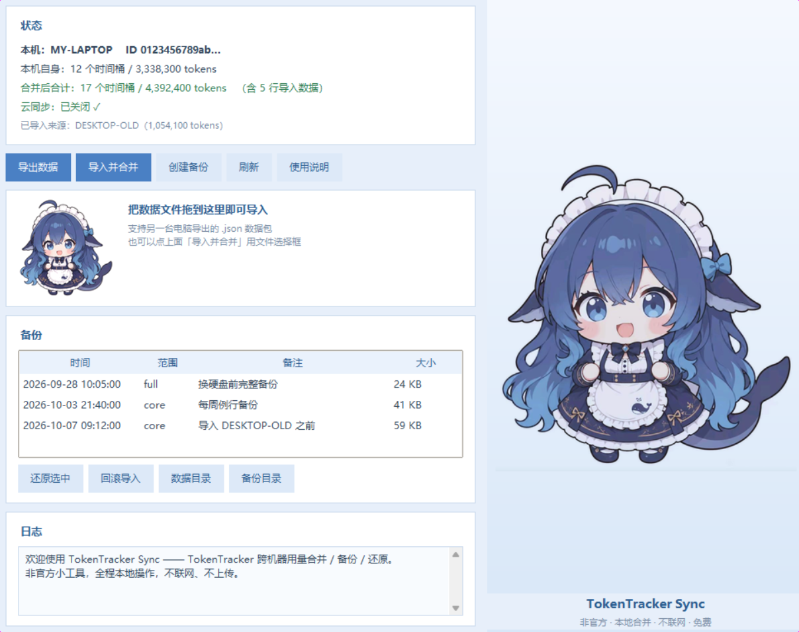

# TokenTracker Sync

**Merge your TokenTracker usage data across multiple computers — locally, for free.**

[](LICENSE)
[](https://www.python.org/)
[](#legal--disclaimers)

[中文说明](README.zh-CN.md) · [Merge rules](docs/MERGE-RULES.md) · [Changelog](CHANGELOG.md)



---

## Why this exists

[TokenTracker](https://github.com/xiufengsun/TokenTracker) is a great local-first AI coding usage tracker. But it has one gap: **there is no local export/import of usage data.** If you use two computers and want to see the combined total, the only official answer is its paid Cloud sync (`$4.99/month`).

This was verified against the upstream repo:

| Checked | Result |
|---|---|
| README mentions exporting local usage data | ❌ Only `status --json` (a summary for agents), not a data export |
| README mentions importing local data | ❌ The word never appears |
| Multi-device merge | 🔒 Cloud only: *"Optional cloud sync merges usage across your machines"* |
| Official roadmap for local export/import | ❌ None. `docs/cloud-guide.md` lists sync **and backups** as paid Cloud services |
| Upstream issues asking for this | ❌ `multiple computers` = 0, `export` in title = 0, `backup` in title = 0 |

So `TokenTracker Sync` fills that gap with **plain local files and a USB stick**: no account, no network, no subscription.

> Unofficial community tool. Not affiliated with or endorsed by the TokenTracker project.
> It never modifies TokenTracker itself — it only touches the data files, and always backs them up first.

---

## The one thing that makes this non-trivial

You cannot just copy or concatenate the data files. TokenTracker reads its queue and deduplicates by **`source | model | hour_start`**, keeping only the **last** row per key — it never adds them up. That produces two opposite semantics:

| Case | Correct handling | Naive concat gives you |
|---|---|---|
| Same key repeated **on one machine** (cumulative updates for that hour) | Keep the **last** one | ✅ happens to be right |
| Same key on **two machines** (each machine's own usage in that hour) | **Sum** them | ❌ one machine's data is silently lost |

Getting this backwards loses data or double-counts it. `TokenTracker Sync` does `last-wins per machine`, then `sum across machines`, and writes the result back with an idempotency marker so repeated imports never accumulate.

Details: [docs/MERGE-RULES.md](docs/MERGE-RULES.md)

---

## Features

- 🔀 **Export / import** — merge two machines' usage into one view
- 💾 **Full backup / restore** — a single-file snapshot of the key data, byte-exact restore
- 🧾 **Idempotent** — importing the same file again changes nothing
- 🛡️ **Safe** — auto-backs up before every import; refusing to import your own export; refuses to run while Cloud sync is on (unless forced)
- 🔍 **Self-describing exports** — every export carries a `_spec` field documenting the merge rules, so an AI or a human on the other machine can do it correctly without this README
- 🖱️ **GUI** — a single `.exe` with export / import / backup / restore; drag a data file in, or drop it onto the exe icon
- ⌨️ **CLI** — the same logic, scriptable
- 🧩 **Zero third-party dependencies** in the core (stdlib only)

---

## Quick start

### Option A — the .exe (Windows, simplest)

1. Download `TokenTrackerSync.exe` from [Releases](../../releases) and put it anywhere (e.g. next to your TokenTracker install).
2. Turn **off** Cloud sync in TokenTracker on both machines.
3. On machine A: run `TokenTrackerSync.exe` → **导出数据** → pick the USB drive → you get one `tt-usage-<machine>-<time>.json`.
4. On machine B: run `TokenTrackerSync.exe` → **导入并合并** → select that file (or just drag it onto the window / onto the exe icon).
5. Open TokenTracker — the dashboard now shows A + B. No restart needed.

To make machine A show the combined total too, export from B and import it on A. It is **bidirectionally safe**: exporting never includes data you imported, so A↔B round trips never double-count.

### Option B — from source

```bash
git clone https://github.com/<you>/tokentracker-sync.git
cd tokentracker-sync
python tokentracker-sync.py            # GUI
python tokentracker-sync.py status     # CLI
```

Requires Python 3.8+ with tkinter (bundled with the official Windows/macOS installers). No `pip install` needed.

### Build the exe yourself

```bash
pip install pyinstaller tkinterdnd2
pyinstaller --noconfirm --onefile --noconsole --name TokenTrackerSync --collect-all tkinterdnd2 tokentracker-sync.py
# result: dist/TokenTrackerSync.exe
```

Or just run `packaging/build_windows.bat`.

---

## CLI reference

```bash
python tokentracker-sync.py                            # GUI
python tokentracker-sync.py <data-file.json>           # GUI + import that file directly

python tokentracker-sync.py export --to "E:\"          # export (--format json|csv, json default)
python tokentracker-sync.py import "E:\tt-usage-*.json" --dry-run   # preview only
python tokentracker-sync.py import "E:\tt-usage-*.json"             # merge for real
python tokentracker-sync.py status                     # local total + imported sources

python tokentracker-sync.py backup --note "monthly"    # full backup (single file)
python tokentracker-sync.py backups                    # list backups
python tokentracker-sync.py restore-backup 0           # restore a backup (overwrite)
python tokentracker-sync.py restore 0                  # roll back one import (pre-import backup)
```

### Merge vs backup — don't mix them up

| | Purpose | Effect on data | File |
|---|---|---|---|
| `export` / `import` | **Merge two machines** | Adds them together | `tt-usage-<machine>-<time>.json` |
| `backup` / `restore-backup` | **Roll one machine back** | **Overwrites** current data | `tt-backup-<machine>-<time>.json` |

Never restore machine A's full backup onto machine B — that destroys B's own data.

---

## Limitations

1. **Turn Cloud sync off first.** Import rewrites `queue.jsonl`, which invalidates the byte offset used for cloud uploads. The tool refuses to run while it's on unless you pass `--force`.
2. **The most recent hour can briefly look low.** TokenTracker occasionally re-emits the current hour's bucket, and that fresh row supersedes the synthesized one. **Re-running the import fixes it** (idempotent — it won't double-count). Anything older than a day is unaffected.
3. **Same hour on both machines with the same model = summed.** That's correct — it's two machines' real usage.
4. **Cloud session-state control records are not transferred.** They're per-device cloud bookkeeping; your own records are preserved byte-for-byte.
5. **The web dashboard's cross-device view is still Cloud-only.** This tool only affects the local desktop dashboard.

---

## Verifying it's safe

```bash
python tests/diff_test.py
```

Runs the merge on synthetic two-machine data in a temp directory and asserts: cross-machine summing, in-machine last-wins, idempotency, control-record preservation, and — because the original tool was written in JavaScript — a **differential test against the JS implementation**, asserting identical per-bucket numbers and totals.

## How is this different from other tools?

There are several projects that aggregate AI usage across machines. They generally
fall into two camps — and this one is deliberately neither:

| | Other multi-machine tools | This project |
|---|---|---|
| What it is | A **standalone tracker** (you switch to it) | An **add-on for TokenTracker** (you keep using it) |
| Data source | Reads each AI tool's raw logs | Reads TokenTracker's already-aggregated `queue.jsonl` |
| Transport | Self-hosted server, Docker, WebDAV, GitHub Gist/repo, VPN | **A file and a USB stick** |
| Network required | Yes | **No — none at all** |
| Account required | Usually | **No** |
| Cost | Free (plus your infra) | Free |

None of the existing tools does "copy one file across and merge", and none of them
understands TokenTracker's dedup semantics. See [docs/PRIOR-ART.md](docs/PRIOR-ART.md)
for the survey, including what each alternative does and where the trade-offs are.

## Security

The one attack surface here is **the data file you import**. So the import path is
treated as untrusted input and validated up front:

- Numbers must be finite — `NaN` / `Infinity` are rejected, and the writer can never
  emit them (they are invalid JSON and would break TokenTracker's own reader)
- Rows are cleaned against a **numeric field allowlist**, so a crafted file cannot
  inject arbitrary fields into your queue
- Size limits on the file, on rows per queue, and on how many source machines are recorded
- Restores are confined to the data directory by resolved-path check
- Unparseable existing lines are preserved verbatim, never silently dropped

Verified by `python tests/security_test.py` (15 assertions, each tied to a specific
finding). Full threat model, findings and fixes: [docs/SECURITY.md](docs/SECURITY.md).

## Legal & disclaimers

- **Unofficial.** This project is not affiliated with, endorsed by, or sponsored by TokenTracker.
  It interoperates with TokenTracker's on-disk file formats only; no upstream source code was copied.
- **No network access.** The program contains no networking code — you can read the source to confirm.
- **Third-party licenses** bundled in the released binaries (CPython, Tcl/Tk, tkinterdnd2, PyInstaller
  bootloader) are documented in [THIRD_PARTY_NOTICES.txt](THIRD_PARTY_NOTICES.txt).
- Full risk analysis, trademark discussion, artwork licensing and distribution caveats:
  [docs/LEGAL-AND-RISKS.md](docs/LEGAL-AND-RISKS.md)
- Maintainer? See [docs/RELEASING.md](docs/RELEASING.md) for the release process.

## Layout

```
TokenTracker Sync/
├── tokentracker-sync.py            entry point (GUI by default)
├── ttsync/
│   ├── core.py           merge / export / backup / restore (stdlib only)
│   ├── cli.py            command line
│   └── gui.py            tkinter GUI
├── assets/               generated UI images (bg / mascot / icon)
├── art/mascot.jpg        source artwork
├── tests/diff_test.py    differential + regression tests
├── tests/security_test.py  security regression tests
├── packaging/            asset generator + PyInstaller build script
└── docs/MERGE-RULES.md   exact merge semantics
```

## Artwork

`art/mascot.jpg` is the source illustration used for the window background, the
in-window mascot and the app icon. The files in `assets/` are generated from it by
`python packaging/make_assets.py`.

**If you fork this project, replace `art/mascot.jpg` with artwork you own or that is
licensed for reuse** — or delete `art/` and the `assets/*.png|ico` files and the GUI
will simply render without a background image.

## License

MIT — see [LICENSE](LICENSE).
